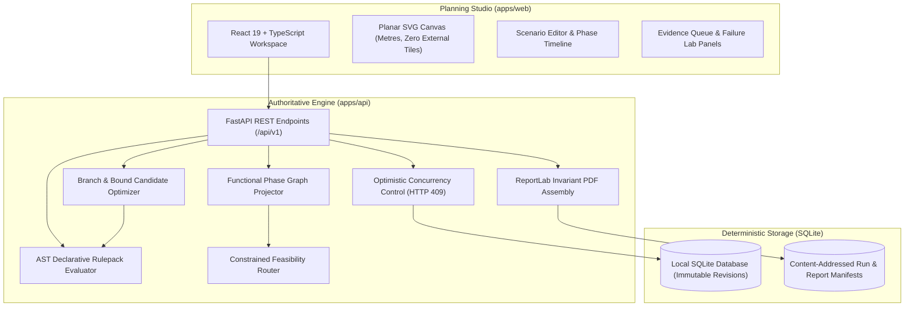
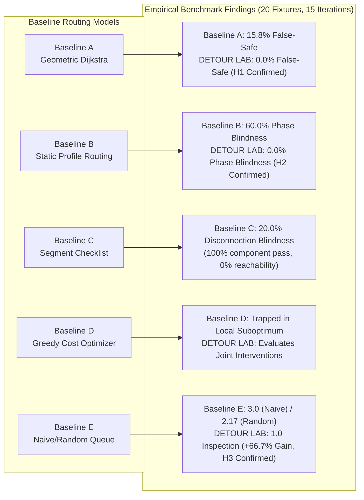

# DETOUR LAB

**Pre-Construction Pedestrian Accessibility Decision-Support & Model Verification System**

[](LICENSE)
[](https://www.python.org/)
[](https://nodejs.org/)
[](var/release/manifest.json)

---

## 1. What DETOUR LAB Does

**DETOUR LAB** is an offline, local-first engineering decision-support system designed for civil engineers, municipal transportation planners, and pedestrian accessibility auditors. It evaluates pedestrian reachability through active construction zones before construction begins.

Traditional routing software treats pedestrian networks as static, vehicle-like centerlines and assumes unobserved segments are passable. In contrast, DETOUR LAB evaluates an explicit planar network of sidewalks, crossings, and curb interfaces against multi-profile accessibility standards, accounts for scheduled construction closures across temporal phases, resolves incomplete and conflicting field evidence under four-valued logic, and provides bounded, authoritative detour optimization.

> [!IMPORTANT]
> **Research and Planning Prototype Disclaimer:**
> DETOUR LAB is a model-verification and decision-support prototype. Verdicts indicate mathematical satisfaction against modeled declarative rules; they **do not** constitute statutory legal compliance (e.g., ADA, Section 504, PROWAG) or a guarantee of physical pedestrian safety. The bundled study area dataset and rulepack (`DEMO_RULEPACK_NOT_LEGAL`) are synthetic demonstration fixtures designed for algorithmic verification.

---

## 2. Core Capabilities

### Four-Valued Epistemic Evidence
Mainstream GIS tools adopt an "open-world assumption" where unmeasured sidewalks are assumed passable, generating dangerous false-safe routes. DETOUR LAB implements Belnap-Dunn four-valued epistemic reasoning:
- **`Confirmed Reachable`**: Every constituent segment on the path provably satisfies the active profile rulepack.
- **`Possible-Only (Unknown)`**: A topological path exists, but one or more segments lack field evidence (e.g., unmeasured curb lip or slope).
- **`Failed`**: At least one required segment violates an admissibility threshold (e.g., slope $\ge 8.33\%$ for manual wheelchairs).
- **`Disconnected`**: No topological path connects origin and destination under the active phase.

### Multi-Profile Evaluation
Pedestrian accessibility is heterogeneous. A corridor passable for an ambulatory pedestrian or power wheelchair may be impassable for a manual wheelchair user. DETOUR LAB evaluates networks against independent declarative profile rulepacks without homogenizing mobility requirements.

### Temporal Construction Phase Projections
Construction phasing introduces sequential closures and ephemeral corridors. DETOUR LAB models phases ($T_0, T_1, \dots$) as pure functional projections over the base graph:
$$\text{PhaseGraph} = f(\text{BaseGraph}, \text{ScenarioRevision}, \text{PhaseID})$$
This guarantees zero phase bleed, multi-user concurrency without database corruption, and bit-for-bit replayability.

### "Fix This Plan" — Authoritative Bounded Optimization
When construction severs a compliant corridor, planners cannot rely on unconstrained heuristics. The optimization engine searches an enumerated candidate library of modular interventions (temporary ramps, surface repairs, phase rescheduling). Critically, **every candidate combination is re-verified by the authoritative backend engine** before recommendation, rejecting non-compliant solutions.

### Decision-Blocking Evidence Queue
Municipal survey budgets are constrained. The Evidence Queue ranks unmeasured infrastructure attributes by their topological decision-blocking impact on critical paths, rather than presenting an unsorted inventory list.

### Adversarial Failure Lab
Planners can stress-test detour plans against deterministic, authored fault suites: critical corridor closures, unannounced barricades, contradictory evidence injection, and temporal survey expiration.

### SHA-256 Digest-Verified Engineering PDF Reports
Generates formal, 9-page audit-ready PDF review packets using invariant layout primitives. Each document embeds the exact engine version, rulepack hash, and SHA-256 digest verified against the server manifest.

---

## 3. System Architecture



### Technology Stack
- **Backend**: Python 3.12, FastAPI, SQLAlchemy 2.0 (ORM & transactional SQLite), Pydantic v2, ReportLab (invariant PDF assembly), NetworkX.
- **Frontend**: React 19, TypeScript (strict mode, zero `any`), Vite, Tailwind-free semantic CSS tokens, accessible HTML5 / ARIA primitives.
- **Verification**: Pytest (538 backend tests), Vitest (127 frontend tests), Playwright (106 end-to-end browser tests), Axe-core accessibility scanner.
- **Network Operation**: **100% Offline**. Zero external CDNs, Google Fonts, remote basemaps, or cloud telemetry.

---

## 4. Repository Structure

```
DETOUR-LAB/
├── apps/
│   ├── api/                    # Authoritative FastAPI backend & domain engines
│   │   ├── detour_lab/         # Graph, rules, evidence, phases, failure, reporting
│   │   └── tests/              # 538 backend pytest integration & unit tests
│   └── web/                    # React 19 planning studio & client workspace
│       ├── e2e/                # 106 Playwright browser specs across 4 viewports
│       ├── src/                # Accessible canvas, studio features, components
│       └── tests/              # 127 Vitest component & unit tests
├── data/
│   └── demo/                   # Synthetic study area & intervention demo fixtures
├── docs/
│   ├── architecture/           # Decisions, system flow, optimization & failure lab specs
│   ├── development/            # Test plan, postmortems, requirements traceability
│   ├── evaluation/             # Research benchmarks (H1-H3), technical defense, readiness audit
│   ├── guides/                 # 5-minute offline demonstration runbook
│   ├── internal/               # Project brief and execution history
│   ├── reference/              # Product requirements document (PRD)
│   └── security/               # 20-point threat model & hardening review
├── packages/
│   └── contracts/              # OpenAPI specs and synchronized TypeScript bindings
├── scripts/                    # Setup, verification, manifest and benchmark utilities
├── var/                        # Local runtime databases, benchmarks, and release manifests
├── LICENSE                     # Apache 2.0 License
└── README.md                   # Primary project documentation
```

---

## 5. System Requirements & Installation

### Prerequisites
- **Operating System**: Windows 10/11 (or Linux / macOS)
- **Python**: 3.12+ 64-bit (`python --version`)
- **Node.js**: 20+ LTS and npm (`node --version`, `npm --version`)
- Internet access is required **only** during initial installation to fetch dependencies from PyPI and npm.

### Automated Setup (Windows PowerShell)

```powershell
# Clone repository and enter directory
git clone https://github.com/PrathamKapoor/Detour-Lab.git
Set-Location Detour-Lab

# Execute automated setup script
powershell -NoProfile -ExecutionPolicy Bypass -File scripts\setup.ps1
```

The setup script:
1. Creates a Python virtual environment at `.venv` and installs pinned backend dependencies.
2. Installs frontend dependencies via `npm ci`.
3. Downloads the standalone Chromium browser runtime for Playwright end-to-end testing.
4. Generates OpenAPI schema contracts.

---

## 6. Running the Application (Offline Demonstration)

DETOUR LAB runs entirely on your local machine with two processes.

### Terminal 1: Backend API Service

From the repository root:

```powershell
$env:PYTHONPATH = (Join-Path (Get-Location) "apps\api")
.\.venv\Scripts\python.exe -m uvicorn detour_lab.api.main:app --app-dir apps\api --host 127.0.0.1 --port 8077
```
The API becomes healthy at `http://127.0.0.1:8077/api/v1/health`.

### Terminal 2: Web Planning Studio

From the repository root:

```powershell
Set-Location apps\web
npm run dev
```
Open your browser to `http://127.0.0.1:5173`. The application automatically connects to the backend on `:8077`.

For a structured demonstration flow for evaluators or judges, consult the [5-Minute Offline Demonstration Runbook](docs/guides/DEMO_WALKTHROUGH.md).

---

## 7. Verification & Benchmarking

The complete test suite and verification pipeline can be executed with a single command from the repository root:

```powershell
powershell -NoProfile -ExecutionPolicy Bypass -File scripts\verify.ps1
```

### Pipeline Checks Executed (Exit Code 0 Required):
1. **Ruff Linter**: Python syntax and formatting checks (`ruff check .`).
2. **Backend Test Suite**: **538 pytest tests** covering domain logic, graph routing, security hardening, and benchmarks.
3. **TypeScript Typecheck**: `tsc --noEmit` under strict mode.
4. **ESLint**: Static analysis of React components (0 errors).
5. **Vitest Suite**: **127 unit and component tests** in the web workspace.
6. **Production Build**: Production bundle compilation via Vite (sub-2 second build).
7. **Playwright E2E Suite**: **106 browser tests** across desktop and mobile viewports.
8. **Live HTTP Smoke & Persistence**: Verification of idempotent re-evaluation and SQLite persistence across server restarts.
9. **API Contract Determinism**: Verification of OpenAPI specifications and TypeScript bindings.
10. **Review Packet Generation**: PDF generation and SHA-256 byte-level verification.
11. **Research & Scalability Benchmarks**: Execution of Baselines A–E across fixtures F01–F20 and grid scaling workloads.
12. **Release Candidate Manifest Verification**: Audit of `var/release/manifest.json`.

---

## 8. Empirical Research Evaluation

Detailed scientific methodology, formal proofs, and raw data are documented in [Research Evaluation](docs/evaluation/RESEARCH_EVALUATION.md).



### Empirical Results Summary:
- **Hypothesis H1 (Accessibility Fidelity — Confirmed):** Baseline A (Geometric Shortest Path) produced a **15.8% false-safe error rate**, routing users across illegal slopes $\ge 8.33\%$ or impassable widths. DETOUR LAB achieved a **0.0% false-safe rate** across all 20 fixtures.
- **Hypothesis H2 (Temporal Phase-Awareness — Confirmed):** Baseline B (Static Routing) exhibited a **60.0% phase-blindness error rate** during phase transitions. DETOUR LAB achieved **0.0% phase blindness**.
- **Hypothesis H3 (Evidence Prioritization — Confirmed):** Prioritizing unresolved attributes by decision-blocking weight resolved OD reachability in **1 inspection** on Fixture F17, compared to **3 inspections for naive ordering** (+66.7% efficiency gain) and a mean of **2.17 inspections for random ordering** (+53.8% gain).
- **Scalability Latency Profile:**
  - Small (16 nodes, 48 edges): Routing p50 = 0.31 ms | Rule Eval p50 = 24.37 ms
  - Medium (64 nodes, 224 edges): Routing p50 = 1.53 ms | Rule Eval p50 = 113.23 ms
  - Large (256 nodes, 960 edges): Routing p50 = 6.85 ms | Rule Eval p50 = 573.26 ms
  - Stress (1,024 nodes, 3,968 edges): Routing p50 = **31.51 ms** (p95 = 32.30 ms) | Rule Eval p50 = 2,459.90 ms
  - Demonstrates that interactive pathfinding remains sub-32 ms at city-block scale.

---

## 9. System-Wide Reproducibility

DETOUR LAB guarantees strict mathematical determinism across 16 core dimensions:
1. Input coordinate normalization and planar topological indexing.
2. Abstract Syntax Tree (AST) rulepack parsing.
3. Belnap-Dunn 4-valued state algebra resolution.
4. Functional phase-graph projection.
5. Feasibility subgraph filtering and Dijkstra path traversal.
6. Combinatorial candidate intervention enumeration.
7. Decision-blocking priority queue ranking.
8. Deterministic random seeds in stress-testing suites.
9. ReportLab invariant canvas coordinate layout.
10. SHA-256 byte-level PDF checksum verification.
11. Optimistic concurrency control conflict resolution (HTTP 409).
12. Schema generation and TypeScript interface synchronization.
13. SQLite transaction isolation across cold reboots.
14. Content-addressed scenario revision hashing.
15. Seeded synthetic study area idempotency.
16. Cryptographic release manifest auditing (`var/release/manifest.json`).

---

## 10. Known Scope & Operational Boundaries

To maintain rigorous engineering defensibility, DETOUR LAB maintains clear boundaries:
- **Synthetic Demonstration Rulepacks**: The bundled rulepack (`DEMO_RULEPACK_NOT_LEGAL`) is an illustrative threshold set for software verification, not a legal standard. Real-world municipal deployments must author localized jurisdiction packs.
- **Discrete Edge Modeling**: The system evaluates properties on discrete directed edges. Intra-segment micro-obstructions (e.g., temporary contractor signs narrowing a sidewalk for 2 meters) must be modeled as discrete sub-segments.
- **Illustrative Intervention Costs**: The demo intervention library includes illustrative figures (in INR) labelled `demo_only`. They are not contractor quotes and are never used as authoritative financial forecasts.
- **Pre-Construction Decision Support**: DETOUR LAB is designed for planning and design review. It does not replace on-site physical engineering inspections.

---

## 11. License

DETOUR LAB is open-source software licensed under the **Apache License, Version 2.0**. See the [LICENSE](LICENSE) file for details.
