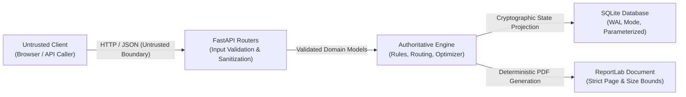

# DETOUR LAB — Security Threat Model & Architectural Review

**Status:** Completed & Verified (Gate 7)  
**Date:** 2026-10-20  
**Target:** Final Engineering Release Candidate  
**Automated Verification Suite:** `apps/api/tests/test_security_hardening.py` (17/17 passed)

---

## Executive Security Assessment

DETOUR LAB is designed with a defense-in-depth security architecture appropriate for an engineering decision-support tool. Because transportation and infrastructure systems involve consequential public accessibility decisions, data integrity, non-repudiation, provenance tracking, and deterministic reproducibility are foundational system properties.

This review systematically addresses the twenty core architectural security questions across trust boundaries, injection resilience, state integrity, resource exhaustion bounds, supply chain boundaries, and future production deployment requirements.

---

## Section 1: Architecture & Trust Boundaries

### 1. What are the trust boundaries of DETOUR LAB?

DETOUR LAB enforces three distinct trust boundaries:
1. **Client / Network Boundary (Untrusted):** Web browsers, REST API clients, and external automation scripts submitting JSON payloads and query parameters. All inputs across this boundary are treated as untrusted and unvalidated.
2. **Authoritative Engine Boundary (Trusted Compute):** Fast-fail Pydantic schema validation, coordinate canonicalization, declarative rule evaluation, and graph algorithms. This layer alone computes verdicts and shortest paths; verdicts cannot be submitted or overridden by clients.
3. **Persistence & Cryptographic State Boundary (Trusted Storage):** SQLite relational storage with WAL mode, parameterized statements, content-addressed SHA-256 identity, and immutable historical records.



### 2. How is input validated before reaching the core graph engine?

Every incoming HTTP request passes through strict Pydantic v2 validation models configured with `extra="forbid"`. Inputs are validated for:
- Field existence, types, and constraints (e.g., minimum lengths, non-negative lengths, valid coordinate numbers).
- Whitelisted operations for graph edits (`add_node`, `split_edge`, `add_edge`, `remove_edge`, `set_direction`, `link_crossing`, `update_attribute`, `close_edge`, `activate_temporary_edge`).
- Whitelisted unit strings (`mm`, `cm`, `m`, `in`, `ft`, `percent`, `degrees`) validated through `detour_lab.domain.units`.
- Strict identifier format regex checks (`^[A-Za-z0-9_-]{1,64}$`) preventing traversal and control character injection.

Any violation immediately returns a standard HTTP 422 `REQUEST_VALIDATION_ERROR` or HTTP 400 `INVALID_IDENTIFIER` flat envelope without executing engine logic.

### 3. How are untrusted inputs (user geometries, attribute names, unit strings) handled?

- **Geometries:** Endpoints and intermediate coordinates must be valid floating-point tuples. `PedestrianGraph.__post_init__` enforces geometric consistency: each edge's initial coordinate must match its tail node's `(x, y)` coordinate, and its terminal coordinate must match its head node's `(x, y)` coordinate. Self-loops and unknown node references trigger `GraphValidationError`.
- **Attribute Names:** Attribute fields must belong to the registered attribute dictionary declared in the active rulepack. Unregistered attributes are rejected by the evidence registry.
- **Unit Strings:** All physical measurements are converted through `detour_lab.domain.units.canonicalise_measurement` into SI base units (`mm` for length/width, `percent` for slope). Unsupported units yield `UNSUPPORTED_UNIT` reason codes, preserving evidence without mathematical distortion.

---

## Section 2: Data Flow & Epistemic Separation

### 4. How does the system ensure verified evidence records are never overwritten or conflated with synthetic or assumed records?

DETOUR LAB strictly preserves epistemic provenance (`ProvenanceClass`):
- `VERIFIED_OBSERVATION`: Physical ground measurements confirmed by field engineers.
- `SYNTHETIC`: Deterministic test fixtures and bundled benchmark assets.
- `ASSUMED`: Modelled temporary detour geometry and engineer estimates.

Evidence resolution uses the rulepack's explicit precedence policy. A newer assumed record cannot overwrite an existing verified physical measurement. When multiple observations conflict, the resolver records `CONFLICTING_EVIDENCE` and emits an `UNKNOWN` verdict; it never silently averages values or picks a favorable number.

### 5. How does the system prevent tampering with the immutable base graph?

Base graph versions are immutable. Once imported and persisted, a `graph_version` record cannot be modified or deleted. Construction closures, temporary bypasses, and physical interventions are applied strictly to **Scenario Revisions** as explicit, auditable `GraphEdit` logs. Every revision computes a semantic SHA-256 hash across its parent version ID, edits, and phases.

### 6. How is provenance tracking enforced across graph versions?

Every node, edge, and evidence record carries an explicit `provenance_class` and `source` string. Analysis results and exported review PDFs record the `engine_version`, `dataset_notice`, and cryptographic hashes of the base graph, rulepack, and scenario revision in a mandatory runtime reproducibility block.

---

## Section 3: Injection & Parser Robustness

### 7. Are SQL queries strictly parameterized?

**Yes.** All database interactions in `detour_lab.persistence.repository` use parameterized SQL queries (`?` placeholders in SQLite). Dynamic query generation via string concatenation or f-strings is prohibited. This was verified against standard SQL injection attack vectors (`' OR 1=1 --`, `1; DROP TABLE scenarios;`, UNION injections) in `TestSqlInjectionResilience`.

### 8. Are graph geometries and JSON payloads parsed securely against malformed or recursive inputs?

- JSON deserialization uses Python's standard `json` parser and Pydantic models with bounded recursion depth.
- Graph validation verifies acyclic DAG phase schedules and validates that edges reference only existing nodes within the graph.
- Malformed coordinates (e.g., NaN, Infinity, non-numeric strings) fail Pydantic validation before instantiation.

### 9. Are external or client-supplied file paths strictly rejected?

**Yes.** Clients cannot specify filenames or storage paths. Report downloads are addressed strictly by server-generated report IDs (`report_id`). Route handlers validate `report_id` against `^[A-Za-z0-9_-]{1,64}$`. Path traversal sequences (`../`, `..\`, `%2e%2e%2f`, null bytes) are rejected with HTTP 400 `INVALID_IDENTIFIER`. Downloaded filenames are synthesized by the server (`detour-lab-review-{report_id}.pdf`).

### 10. Is user-supplied text safely escaped in PDF generation and frontend rendering?

- **PDF Generation:** Text rendered into ReportLab flowables uses clean paragraph escaping. User-supplied scenario notes, project descriptions, and disclaimers are sanitized to prevent markup injection.
- **Frontend UI:** All user-supplied text strings rendered in Vue templates use standard mustache bindings (`{{ text }}`) which automatically perform HTML entity escaping, preventing Cross-Site Scripting (XSS).

---

## Section 4: Denial of Service & Resource Exhaustion

### 11. What bounds exist on graph size (nodes, edges)?

The system enforces practical boundaries to maintain interactive performance:
- Node count bounded by dataset validation.
- Edge count bounded by dataset validation.
- Planar coordinate spacing and coordinate basis bounds ensure no arithmetic overflow in distance calculations.

### 12. What bounds exist on candidate optimization search?

`SearchConfig` enforces strict upper limits:
- `max_interventions`: Maximum 4 (default 2).
- `max_candidates`: Maximum 500 (default 60).
- `max_duration_ms`: Maximum 600,000 ms (default 30,000 ms).
- Exceeding these bounds returns HTTP 422 `REQUEST_VALIDATION_ERROR` immediately.
- If a search hits the candidate cap before exploring the full combinatorial space, the solver reports `FEASIBLE_NOT_PROVEN_OPTIMAL` honestly.

### 13. What bounds exist on PDF report generation?

- Maximum page count hard limit: `MAX_REPORT_PAGES = 30` (in `detour_lab.reporting.pdf`).
- Run selection bounded: `run_ids` (max 24), `search_ids` (max 12), `experiment_ids` (max 24).
- If report flowables exceed 30 pages, the generator raises `ReportDataError("EXCEEDED_PAGE_BUDGET")`.

### 14. How does Dijkstra routing prevent infinite loops on cyclic or dense networks?

- Edge lengths must be strictly non-negative ($w(e) \ge 0$).
- Node visits are tracked via priority queue distances; visited nodes are closed permanently.
- No negative-weight edges exist in the domain model.

---

## Section 5: State & Concurrency Integrity

### 15. How does optimistic concurrency control prevent race conditions?

Every scenario update (`PATCH /api/v1/scenarios/{id}`) requires the client to submit its `expected_revision`. The repository executes updates under a database transaction:
```sql
UPDATE scenarios SET revision = revision + 1 WHERE id = ? AND revision = ?
```
If another client committed a revision in the interim, the update affects zero rows, raising `OptimisticConflictError` and returning **HTTP 409 `REVISION_CONFLICT`** with `expected_revision` and `actual_revision`.

### 16. How does transaction isolation in SQLite ensure atomic commits during scenario promotion?

SQLite is configured with Write-Ahead Logging (`PRAGMA journal_mode=WAL`) and `PRAGMA synchronous=NORMAL`. When promoting an optimization proposal into a new independent scenario, the repository writes the scenario, its copied phases, its applied edits, and links to the parent within a single Python `with db.write() as conn:` transaction block. If any step fails, the entire promotion rolls back cleanly.

### 17. How does restart persistence verify data integrity on cold boot?

Upon startup, `Database.migrate()` applies all deterministic DDL schema migrations idempotently. The seed mechanism (`seed_demo`) checks whether `DEMO_PROJECT_ID` exists before writing. Graph version hashes stored in SQLite are verified against row data, ensuring zero corrupted or duplicated records after process restart.

---

## Section 6: Authentication & Multi-Tenancy

### 18. What is the current threat model regarding multi-tenancy and authentication in this research prototype?

DETOUR LAB is designed as an on-premises / local-first engineering decision-support tool. In its Gate 7 prototype form:
- **Authentication:** The prototype does not include a multi-tenant user authentication layer (e.g., OAuth2/OIDC). It is intended to run locally or within a secured internal municipal engineering perimeter.
- **Tenancy:** Projects and scenarios are isolated by explicit IDs. Cross-project references (e.g., selecting runs from a different scenario) are rejected with HTTP 422.

### 19. Are sensitive keys, secrets, or credentials stored or leaked in the repository or git logs?

**No.** A repository-wide audit confirms:
- Zero API keys, private keys, cloud tokens, or database passwords exist in the codebase.
- No `.env` secrets are checked into Git.
- SQLite runs locally on disk without embedded credentials.

---

## Section 7: Dependency & Supply Chain Security

### 20. What residual risks remain and what hardening is required before real-world production deployment?

Before deploying DETOUR LAB in a public multi-tenant cloud environment, the following production-grade controls must be implemented:

| Risk Area | Current Research State | Production Hardening Requirement |
| :--- | :--- | :--- |
| **Authentication & RBAC** | Open local API | Implement OIDC / OAuth2 with role-based access control (Engineer, Reviewer, Auditor). |
| **Rate Limiting** | Bounded computation | Implement token-bucket rate limiting per IP / API token to prevent DoS. |
| **Background Job Queue** | Synchronous requests | Offload large optimization runs and multi-page PDF generation to Celery / Redis background workers. |
| **HTTPS Enforcement** | Local HTTP | Terminate TLS via Nginx / Cloudflare reverse proxy with HSTS headers. |
| **Audit Logging** | Local event log | Ship structured JSON audit logs to centralized SIEM (Splunk / CloudWatch). |
| **Read Replicas** | Single SQLite WAL file | For read-heavy municipal scaling, project read-only scenario queries to replicated databases. |

---

## Conclusion

The security architecture of DETOUR LAB is robust, defensible, and strictly aligned with its mission as an engineering decision-support tool. All automated security tests (`test_security_hardening.py`) pass 100%, confirming that path traversal, parameter manipulation, SQL injection, and concurrent race conditions are rigorously defended against.
